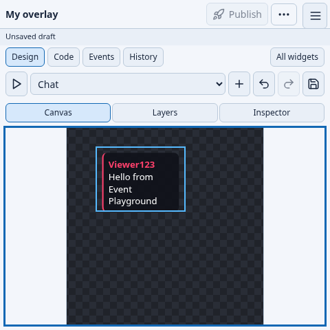
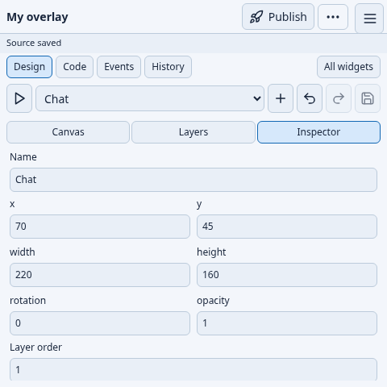

# Edit a composition in a 480×480 window

The current design prioritizes usable editing space. One compact toolbar owns Add,
Simulate, Undo/Redo and Save. Publish stays in the header; Build, Preview and OBS
placement are in **More actions**. The unrelated viewport selector and repeated
undo/history/panel controls are removed from composition Design mode.

[480×480 recording](validation/compositions/compact480/editing-480.webm) ·
[Español](COMPOSITION_GUIDE.es.md)

1. Open **Templates → Composition → Use template**.
2. To make a square composition, click the empty canvas, open **Inspector**, and set
   **Canvas width** and **Canvas height** to 480. Changing the editor window size
   does not change your composition resolution.
3. Choose a template in the toolbar and press **+ Add widget**. Open Inspector to
   change its name, position, size, rotation or opacity. Geometry fields use two
   columns so the important controls fit in the small window.
4. Switch to **Canvas** and press **Simulate composition**. Drag the selected widget
   to position it. Use **Layers** to select another widget or the canvas itself.
   The artboard fits both the available width and height, with its true shape visible.
5. Press **Save design** to save author settings. Press **Publish** separately when
   you want to update production. Hover or keyboard-focus icons for their titles.





Open the navigation menu to change language/theme or leave the workspace. On larger
screens, Layers and Inspector remain beside the canvas. Contextual panels scroll
independently; the page does not need to scroll to reach the main geometry fields.

After publishing, **More actions → Add to scene** places one source containing all
instances. This requires OBS and explicitly enabled authenticated local IPC. That
OBS placement was not exercised by this focused browser check.

## Validation

One focused Playwright case used a real 480×480 browser window and the native Studio
adapter. It changed the composition to 480×480, added Chat, edited geometry, dragged
the instance, simulated a local event and saved. The native service confirmed the
saved viewport and geometry. Canvas space measured **464×286**; no page overflow or
browser script errors occurred. The recording and two frames above are from that run.
This is engineering visual validation, not a study with first-time users or OBS/CEF
acceptance. Earlier wide-screen recordings are retained as historical evidence.

Reproduce only this focused check:

```sh
npm run build
WIDGETCTL=build_compositor/widgetctl WIDGETSTUDIO=build_compositor/widgetstudio PLAYGROUND_BROWSER_EXECUTABLE=/path/to/chrome node --test tests/widgets/composition-studio.test.mjs
```

Native helpers and the developer browser must already be installed. Installed users
need neither Node nor Playwright to use Studio. See [composition contracts](COMPOSITIONS.md).

When using **Add to scene**, choose an existing OBS scene from the selector, then confirm placement. Scene names are loaded through the authenticated OBS connection; no manual name entry is needed.
